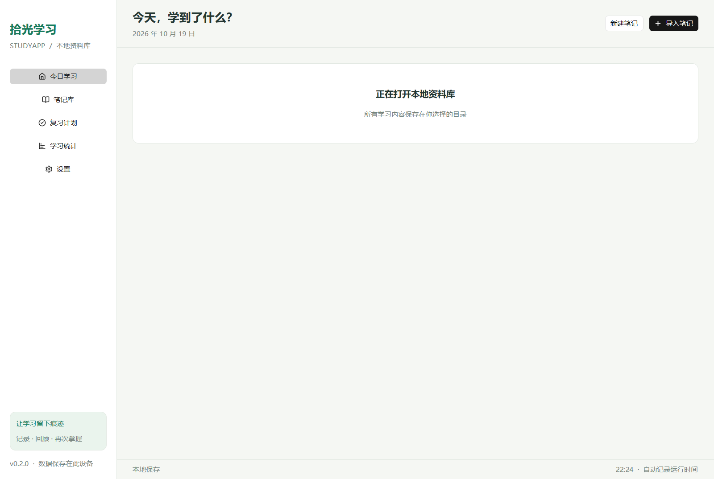
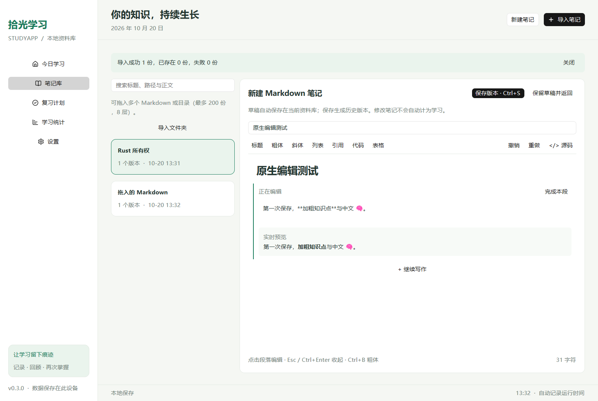
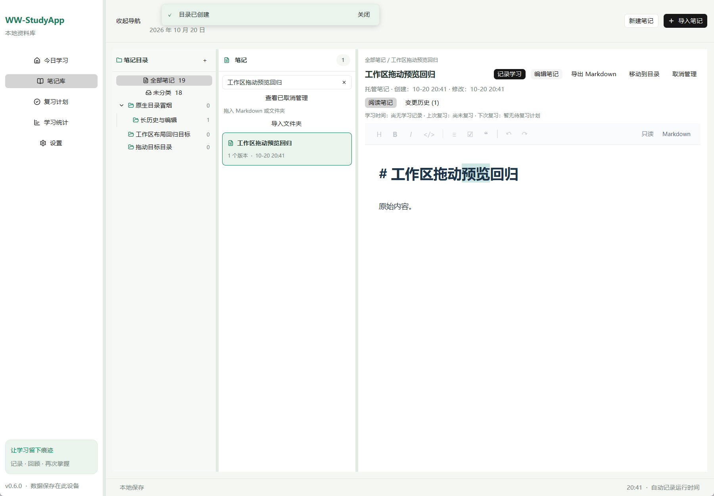

# WW-StudyApp

使用 GPUI Kit 0.7.3 构建的 Windows 中文学习桌面应用。创建或导入自己的 Markdown 笔记，定时确认学习内容，安排间隔复习，并将笔记文件同步到自己的 WebDAV、文件夹或兼容 NAS。无需 WW-StudyApp 账户即可使用。

当前源码版本为 **0.6.0**，采用本地优先存储。笔记库采用可调宽度的目录、笔记列表和正文工作区，主导航可以收起，布局按资料库保存；拖动预览跟随指针，确认操作使用弹窗，执行结果使用顶部浮动提示。支持 Typora 风格的连续原位编辑、即时排版和常见编程语言高亮、版本历史、拖入导入，以及用户自有存储的笔记同步。笔记可拖到目录或通过右键菜单分类；文件路径默认隐藏，可在设置中开启并保存。**同步仅传输最新 Markdown，不传输学习记录、复习计划或完整版本历史**。微信登录和 WW-StudyApp 账户云服务仍为预留接口，见 [同步指南](docs/sync-guide.md) 与 [扩展边界](docs/cloud-contract.md)。



## 启动

发布工作流成功后，可从 [GitHub Releases](https://github.com/xwwpy/StudyApp/releases) 下载对应程序；0.6.0 的包名为 `WW-StudyApp-0.6.0-windows-x86_64.zip`，解压后运行 `WW-StudyApp.exe`。ZIP 是免安装程序包，默认资料保存在用户应用数据目录，而非解压目录。发布程序**未进行代码签名**；尚无自动更新器。版本对应的标签为 `v0.6.0`；是否已发布及可用下载以 Release 实际资产为准。应用显示名称与发布程序名称为 WW-StudyApp，已有资料库、配置、凭据和同步目录标识沿用原名称，可继续使用。

支持 Windows 10/11 x64，编辑器需要 [Microsoft Edge WebView2 Runtime](https://developer.microsoft.com/microsoft-edge/webview2/)。Windows 常见安装已包含；缺失时按页面安装 Evergreen Runtime。编辑器资源完全离线，不需要 Node.js 或外部网站。使用 Windows 图形渲染；远程桌面、显卡驱动及受限运行环境可能影响窗口创建。若系统提示缺少 MSVC 运行库，安装微软 [Visual C++ x64 Redistributable](https://aka.ms/vs/17/release/vc_redist.x64.exe)。Linux CI 测试学习核心和同步库，不提供 Linux 桌面程序。

开发构建需要 Rust **1.98.0**、Visual Studio 2022 C++ 桌面开发工具（含 Windows SDK）、CMake 和 PowerShell 7。在仓库根目录运行：

```powershell
cargo build --locked -p studyapp-desktop
cargo run --locked -p studyapp-desktop
```

开发构建的二进制名称仍是 `studyapp.exe`；打包时复制为 `WW-StudyApp.exe`。

单独指定资料库目录：

```powershell
.\target\debug\studyapp.exe --data-dir "D:\StudyAppData"
```

## 使用与规则

1. 点击「新建笔记」编写标准 Markdown。整篇笔记使用一个连续编辑区，标题、强调、列表、引用、代码、表格在原位排版，光标所在的语法显示 Markdown 标记。可以直接跨段选择、键盘移动、粘贴、撤销与重做；工具栏提供常用格式，**Ctrl+B / Ctrl+I** 格式化，**Ctrl+Z / Ctrl+Shift+Z / Ctrl+Y** 撤销重做，**Ctrl+S** 保存版本。「Markdown / 源码」切换保留选区和撤销历史。托管文件位于资料库的 `notes/<UUID>.md`；保存时检查预期版本，冲突或失败保留草稿，可另存新笔记。
2. 可以多选导入 `.md` / `.markdown`，或直接将多个文件、目录拖入窗口。目录导入最多 200 份 Markdown、8 层目录，不跟随链接或 Windows 重解析点；失败逐项反馈。支持 UTF-8 / UTF-8 BOM，单文件上限 10 MiB。外部原文件只读，需用「复制后编辑」创建托管副本。
3. 笔记库按标题、路径及最新正文搜索，展示创建、修改、最近学习与复习日期；版本历史可阅读旧快照与差异，导出 Markdown 要求新文件名。修改或同步笔记不会自动确认学习。
4. 应用运行时累计学习时间，可以暂停。默认每 **60 分钟**询问一次，可设为 **5–240 分钟**；修改间隔从下一段生效。
5. 时间段结束会显示待回答卡片并尝试发送 Windows 通知。默认 **5 分钟**内填写摘要、确认关联笔记和具体版本快照，可设为 **1–30 分钟**。每份选中笔记至少选择一个版本，可以多选并预览；保存后绑定的内容不会随原文件编辑而改变。拒绝回答或到期未答会记为「未学习」；重启时也会结算已过期记录。
6. 提醒等待时下一段继续计时；关闭、暂停和休眠期间不新增学习时长。正常关闭保存当前累计时间，运行中每 5 秒检查点，异常退出可能损失最后数秒。
7. 确认学习后创建独立复习计划，默认间隔依次为 **1、3、7、14、30 天**。下一阶段从实际复习完成时间起算；逾期保留，勾选可完成，支持撤销最近一次复习。设置支持 1–20 阶段、每阶段 1–3650 天，只影响新计划。
8. 统计按当前本地自然日分组，跨日时按实际时间分配。可以按学习日期筛选记录、手动补记和更正学习记录，学习时长来自用户确认，不能视为对实际专注程度的测量。

导入的外部源文件只读：应用不会改写、删除它们，也不会在笔记目录初始化 Git。托管笔记由应用保存新版本；外部来源需先复制为托管笔记才能在应用内编辑。后台每 **3 秒轮询**已导入文件，发现变化后要求内容稳定至少 **3 秒**再保存快照，因此变化通常需要约 3–6 秒被记录。以哈希去重；首次导入只建立基线，不自动算学习。应用关闭期间无法捕获每次编辑，下次启动只记录最后快照与当前文件之间的离线变化。文件失联保留历史，并支持重新关联。

编辑器支持常见 Markdown、代码和表格，原始 HTML 以文本显示；图片显示 Markdown 说明，链接显示文字，不执行脚本、不自动加载远程图片、不打开链接。版本历史会增加数据库大小，当前没有历史自动清理。



编辑器使用本地打包的 CodeMirror 6 和 WebView2，保留原始 Markdown，不通过 HTML 反向转换；正常编辑和切换模式保持原换行字节。增量解析、可见区域渲染，输入不会重新渲染全文。支持 Rust、Python、JavaScript/JSX、TypeScript/TSX、C/C++、C#、Java、Go、HTML、CSS、JSON、YAML、TOML、SQL、Shell 高亮；未知语言显示普通代码。表格在编辑区域对齐，任务勾选写回 `[ ]` / `[x]` 并支持撤销。单文件上限仍为 10 MiB，超限粘贴会拒绝且保留原文。极大单行或复杂嵌套文档仍可能比普通笔记慢。

草稿在后台自动写入当前资料库的 `note-draft.json`；切换页面继续保留，每库一份。保存、保留、切库和关闭会先确认编辑器末次输入；保留、切库和关闭还会等待草稿落盘确认。写入失败保留窗口和编辑内容。异常退出可能损失最后约 1 秒的输入；草稿不包含在 SQLite 备份中。「删除草稿」可删除当前编辑草稿或待恢复草稿，确认后清空草稿记录，保留原笔记文件及版本。

「取消管理」停止该笔记的文件扫描、学习内容自动归属和同步，将其从笔记库列表移除；原文件、历史、学习与复习记录保留；可用「查看已取消管理」阅读、导出历史或调整目录。已存在的远端同 ID 文件不会被重新导入；再次明确导入同一路径可恢复管理。同步运行时暂时不能取消管理、恢复备份或切换资料库，避免在途上传与这些操作交错。

笔记库将目录树、笔记列表和正文并排显示，目录树与笔记列表分别滚动。拖动主导航、目录树和笔记列表右侧的分隔条可以调整宽度；把主导航分隔条拖到窗口左缘可以收起导航，也可使用顶部的「收起导航 / 显示导航」。宽度与导航显隐按当前资料库保存，重启或切回该库时沿用。窄窗口会临时压缩侧栏，为正文保留空间；放大窗口后恢复偏好宽度。资料库维护期间暂停布局调整。



目录树支持新建目录、子目录、重命名和移动目录，最多 8 层，同级目录不能重名。新建和重命名时，在名称输入框按 **Enter** 即可提交；重复 Enter 不会重复创建，名称校验和维护期间的限制仍然生效。选中目录时新建笔记会保存到该目录。

将列表中的笔记拖到左侧目录或「未分类」即可调整分类；可接受的目标在悬停时突出显示。拖动预览使用指针附近的紧凑卡片，长标题会收纳在卡片内，从条目右下角开始拖动也保持相近的预览距离。也可右键笔记，选择「移动到目录」：可滚动的目的地菜单列出完整目录路径和适用的「未分类」，不包含笔记当前目录；原有「移动到目录」按钮使用相同规则。移动目录时还会排除自身、子孙目录和超出深度限制的位置。资料库切换后产生的过期拖放或菜单动作会被拒绝，维护期间不能移动。

目录操作表单、按钮发起的笔记移动，以及取消管理、删除草稿和逐份清理托管副本的确认，集中在弹窗中处理。弹窗内容在限定高度内滚动，**Tab / Shift+Tab** 在弹窗内切换焦点，**Esc** 取消并返回；弹窗打开时背景操作暂停。操作结果和临时错误显示在顶部浮动提示中，可手动关闭，成功提示会自动收起。提示不改变正文区域的大小，也不接管正在编辑的输入焦点；学习与复习日期的悬停信息继续浮动显示。

可用的按钮、目录项和菜单操作使用手形指针，禁用项保留普通箭头；布局分隔条使用水平调宽指针，便于区分点击和拖动。

笔记右键菜单还提供「在文件资源管理器中显示」和「复制文件路径」，无需先开启路径显示。原文件不存在时会提示，保留的笔记历史仍可查看和导出。「设置」中的「显示文件路径」默认关闭，升级后的旧设置也默认关闭；开启后笔记列表、详情、编辑区及空间管理显示文件位置，保存后重启仍沿用该资料库的选择。

目录是资料库中的分类，移动笔记只改分类元数据，不移动源文件，也不改变其历史。已取消管理的笔记仍可调整目录；删除目录要求它完全没有笔记或子目录。目录分类随资料库和备份保存，目前不会通过仅 Markdown 的同步传输。

「变更历史」中的版本列表与差异正文分别滚动；正文较窄时，版本列表切换为上方可横向滚动的版本条。差异按可见行渲染，不再截断到 1,500 行；超长行按显示宽度分段。选择旧版本后「复制此版本后编辑」创建独立笔记，不覆盖最新版本。

设置中的「更改保存位置并迁移」会先确认输入、持久保存草稿，再将资料复制到新的空目录。成功后下次正常启动继续使用新位置，原资料库保留；失败时继续使用原资料库。带 `--data-dir` 的独立运行只迁移当前会话，不修改全局默认路径。「打开其他资料库」用于切换已有资料库，也会记住选择。

「空间管理」按当前资料库统计数据库/历史、托管副本、保留文件、备份和辅助文件。托管副本列表在自身范围内滚动，滚到顶部或底部时也不会带动外层设置页；在列表之外滚轮仍控制设置页。按文件逻辑长度统计，硬链接可能重复计数，程序安装目录和 WebView2 共享缓存不在统计范围。每个托管副本需单独确认删除；不会删除外部源文件、未知文件或整个目录。副本删除会停止管理，历史和学习记录保留，仍可从「历史与恢复」导出或复制。正在编辑或待恢复草稿关联的副本不能清理。

数据库升级到 schema 3，并兼容读取 schema 1/2。旧版程序不能打开升级后的数据库；升级前请导出备份。取消管理的笔记随备份保留状态，恢复备份不会重建其磁盘文件。

## 连接自己的存储

在「设置 → 笔记文件同步」选择一个目标，保存设置后测试连接，再点击「立即同步」。可选自动同步，间隔 5–1440 分钟；关闭同步仍保留本地资料和远端文件。网络工作在后台进行。

- **文件夹 / NAS**：选择已存在的绝对路径，应用使用其 `StudyApp/notes/<UUID>.md` 子目录。NAS 文件系统须支持操作系统文件锁、硬链接和文件替换；连接测试不能证明全部写入能力。替换前会在 `StudyApp/notes/.retained` 保留原文及暂存内容，目标又被创建时拒绝覆盖；保留目录不会自动清理。文件锁协调 WW-StudyApp 实例，不能为不遵守锁的第三方编辑器提供原子比较与替换保证；存在这种并发写入时应改用正确实现条件请求的 WebDAV。
- **WebDAV**：填写最终 HTTPS 目录地址、用户名和密码或应用密码；TLS 校验启用，拒绝重定向，当前不使用系统 HTTP 代理。服务需支持 MKCOL、Depth:1 PROPFIND、GET、PUT，更新已有对象需返回**强 ETag**并正确执行条件请求。缺少强 ETag 时拒绝覆盖；新对象使用 create-only 请求。HTTP 仅用于显式启用的回环测试构造器，生产设置只接受 HTTPS。

只同步最新 Markdown；学习记录、复习数据、历史快照仍保存在本地 SQLite 中，由「导出备份」保存。双方都修改时先保留本地冲突副本，再接收远端；外部源文件的远端修改创建托管副本。同步不传播删除，也不会清空目录。失败项不推进同步基线，本地在同步期间改变会提示重试。服务兼容性和迁移步骤见 [同步指南](docs/sync-guide.md)。

WebDAV 密码经 **Windows 当前用户 DPAPI** 保护后保存在资料库旁的 `sync-config.json` 中，不进入 SQLite、备份或发布包；设置文件还保存非敏感目标配置和同步基线。换 Windows 用户或设备应重新配置凭据。不要把同步专用目录误当作完整资料备份。

## 数据位置、迁移和恢复

主资料库的托管笔记新建、保存与恢复也要求文件系统支持硬链接，建议使用本地 NTFS；不支持时会在写入意图前预检拒绝并保留草稿。

默认数据库：`%APPDATA%\StudyApp\StudyApp\data\studyapp.sqlite3`。在「设置」查看实际路径；SQLite 同目录可能出现 WAL/SHM 文件及 `studyapp.lock`（运行中的互斥锁）。同一资料库不能被两个窗口同时打开。

「打开其他资料库」切换到该目录的独立资料库，原资料仍留在原处。普通启动将选择结果以 JSON 字符串保存到 `%APPDATA%\StudyApp\StudyApp\config\location.json`，后续启动会使用该目录。`--data-dir` 优先于此配置，并且该次运行的目录切换不会修改全局启动位置。需要回到默认目录时，可在设置中选择默认数据目录。

同一电脑更改保存位置时，使用「更改保存位置并迁移」，选择新的空目录；应用会复制资料、校验并记住新位置。迁移保留原库，外部跟踪文件仍在原处。需要从数据库备份恢复时，先切换到目标资料库，再使用「从备份恢复」。

备份使用 SQLite 在线备份 API，导出为单个一致的数据库文件，要求使用新文件名。恢复会验证应用标识、格式、数据库完整性和业务约束，先在当前资料库目录生成 `studyapp-before-restore-时间-唯一ID.sqlite`，再事务性恢复；不会删除资料目录。数据库升级由版本化 schema 管理，无法识别的较新格式会拒绝读取，升级前建议导出备份。

备份包含笔记内容快照、学习记录、学习设置和复习计划。恢复托管笔记时会从快照重新生成当前资料库下的 `notes/<UUID>.md`，不会使用备份中旧的托管绝对路径。**备份不复制外部原始 Markdown 文件，也不包含草稿、同步配置、同步基线或 DPAPI 凭据**。换电脑后仍可查看快照；外部笔记应另行复制并重新关联，WebDAV / 文件夹同步需重新配置。数据库和备份包含全文及本机路径，没有应用级加密，请自行保管。运行中请使用应用导出备份，避免只复制主数据库而遗漏 WAL 内容。

## 测试和打包

```powershell
cargo fmt --all -- --check
cargo test --locked -p studyapp-core -p studyapp-sync
cargo clippy --locked --workspace --all-targets --all-features -- -D warnings
cargo test --locked --workspace --all-features
cargo build --locked -p studyapp-desktop --features ui-test
$smoke = Join-Path $env:TEMP ('studyapp-smoke-' + [guid]::NewGuid().ToString('N'))
.\target\debug\studyapp.exe --smoke-test --data-dir $smoke
```

冒烟测试必须使用新目录；已有数据库会被拒绝，防止覆盖资料。该模式创建隔离笔记和记录，渲染五个原生页面、点击导航、复习勾选、撤销、暂停和保存设置，并通过后台命令验证备份、恢复后的设置及界面刷新。笔记编辑、草稿恢复、拖入和同步的最终验收证据见 [verification.md](docs/verification.md)。启用 `ui-test` 才会输出 `page-0.png` 至 `page-4.png` 和执行控件断言，成功后输出 `smoke-result.txt` 并退出。`scripts/smoke.ps1 -DataDirectory 新路径` 与 CI 使用同一验证入口，会检查退出状态、报告和截图，保留测试目录作为证据。

```powershell
cargo build --locked --release -p studyapp-desktop
.\scripts\package.ps1 -Version 0.6.0
```

编辑器开发另需 Node.js 22+：在 `crates/studyapp-desktop/editor` 运行 `npm ci`、`npm run check`、`npm run build`、`npm test` 和 `npm run bundle:check`。源码、锁文件与确定性资源一同提交，普通 Rust 构建无需 Node.js。

脚本生成 `dist/WW-StudyApp-0.6.0-windows-x86_64.zip` 与 `.zip.sha256`，包含 `WW-StudyApp.exe`、README、MIT LICENSE、发布说明、同步指南、锁文件及第三方许可证/源代码下载链接。仓库维护了修复原生编辑窗口空白的 GPUI Windows 绘制层补丁，以及统一菜单指针反馈的组件补丁；修改后的完整源码、许可证及来源说明也包含在包内。输出已存在时拒绝覆盖，可用 `-OutputDirectory` 指定新目录；不会删除文件。`-BinaryPath` 允许验证打包其他已构建程序。SHA256 可用 `Get-FileHash -Algorithm SHA256` 核对。

## CI/CD 与依赖

[CI](https://github.com/xwwpy/StudyApp/blob/main/.github/workflows/ci.yml) 在 PR、`main` 和 `codex/**` 推送时检查格式、Windows/Linux 学习核心与同步测试、Windows 全工作区 Clippy 和测试、原生构建及隔离 UI 冒烟；还验证前端类型、离线资源一致性、依赖审计和浏览器回归。截图和结果即使失败也尝试上传；Linux 无 GPU 要求。

[Security](https://github.com/xwwpy/StudyApp/blob/main/.github/workflows/security.yml) 在上述事件及每周运行 `cargo-audit 0.22.2` 和 `cargo-deny 0.20.2`。审计读取提交的 Cargo.lock 和当前 RustSec 数据，不忽略已知漏洞；许可证/来源检查限定支持的 Windows 依赖图，重复版本警告保留。Dependabot 每周检查 Cargo 和固定提交的 Actions。框架传递依赖的告警需要持续跟进，不能把构建通过等同于安全审计通过。

0.5.0 于 2026-10-20 的本地 RustSec 审计报告 **0 个已知漏洞**，[对应提交的远端安全检查](https://github.com/xwwpy/StudyApp/actions/runs/39412304696)也已通过。保留 9 项停止维护警告及非 Windows 依赖 `glib` 的 unsound 警告；没有添加忽略规则。框架传递依赖仍需跟踪上游升级，审计结论仅对应当时锁文件和公告快照，详细证据见 [验证记录](docs/verification.md)。

[Release](https://github.com/xwwpy/StudyApp/blob/main/.github/workflows/release.yml) 仅由 `v*` 标签触发，验证标签等于所有工作区包版本，通过 Windows/Linux 学习核心与同步测试，以及格式、Windows 工作区测试、Clippy、依赖审计和原生 UI 冒烟后构建 Windows release ZIP 和 SHA256，使用最小权限发布 GitHub Release。Actions 固定完整提交，只有发布 job 拥有仓库写权限。工作流定义不代表已在 GitHub 执行成功；实际验证见 [verification.md](docs/verification.md)。

源码采用 [MIT](LICENSE)；依赖遵循各自许可。用户自有存储同步无需部署 WW-StudyApp 服务端；微信登录及账户级全量数据云服务仍需独立后端、密钥和端到端验证。当前没有自动更新器或代码签名。
